<div align="center">



<p>
  <a href="https://yashbank.github.io/"></a>
  <a href="https://www.linkedin.com/in/yash-bankar-9249531aa/"></a>
  <a href="mailto:yashbank2002@gmail.com"></a>
  <a href="https://crestlinetechnologies.in"></a>
</p>


</div>

---

## ⚡ About

Full Stack Developer at **Iauro Systems** (backend on a financial-services platform). Outside work hours I build and ship my own products under **Crestline Technologies**: a factory operations platform, a software-studio marketplace, and AI tools. I use AI coding agents as a force multiplier, while owning architecture, security and testing myself.

```ts
const yash = {
  focus:   ["Product engineering", "Backend & APIs", "AI-assisted workflows"],
  ships:   ["Offline-first apps", "RBAC & audit-logged systems", "Premium dashboards"],
  mindset: "Understand the system first. Ship small. Verify deeply.",
};
```

---

## 🚀 Featured projects

<table>
<tr>
<td width="50%" valign="top">

### 🏭 [PlantPulse](https://github.com/yashbank/plantpulse)
**Factory operations platform** for a 300+ employee plant: QR-kiosk attendance (offline-first Android), payroll, shifts, inventory, production and QC.
<br/>`74 models` · `107 pages` · `534 test files` · `8 roles`

   

</td>
<td width="50%" valign="top">

### 🧱 [CodeKraft](https://github.com/yashbank/CodeKraft)
**Software-studio site + digital-product marketplace** with an admin command centre: payments, append-only finance ledger, approvals, audit log, AI assistant.
<br/>`147 pages` · `540+ test files` · CI + Lighthouse + Playwright

   

[**Live →**](https://crestlinetechnologies.in)

</td>
</tr>
<tr>
<td width="50%" valign="top">

### 🔧 [TradeFlow](https://github.com/yashbank/TradeFlow)
**Operating system for skilled-trade businesses**: customer to quote to dispatch to field work to paid invoice, with no retyping.

  

[**Live →**](https://tradeflow-cyan-nu.vercel.app)

</td>
<td width="50%" valign="top">

### 🧠 [Clinq](https://github.com/yashbank/Clinq)
**AI freelancer OS**: lead discovery, AI proposals, pipeline, follow-ups, automations and client scoring in one app.

  

[**Live →**](https://clinq-delta.vercel.app)

</td>
</tr>
<tr>
<td width="50%" valign="top">

### 🎯 [HiredLens](https://github.com/yashbank/HiredLens)
**AI career intelligence**: resume insights, ATS keyword analysis, AI rewrites and mock-interview setup.

 

[**Live →**](https://hiredlens.vercel.app)

</td>
<td width="50%" valign="top">

### 🎨 [Portfolio sites](https://yashbank.github.io/)
My own [portfolio](https://yashbank.github.io/), plus one I designed and built for my brother: [sarthakbank.github.io](https://sarthakbank.github.io/).

  

</td>
</tr>
</table>

---

## 🧩 Tech

<div align="center">


</div>

| | |
|---|---|
| **Frontend** | React 19, Next.js (App Router), TypeScript, Tailwind CSS, shadcn/ui, Framer Motion |
| **Backend** | Node.js, Python/FastAPI, REST, authentication, RBAC, audit logging |
| **Data** | PostgreSQL, Supabase, Neon, Prisma, Drizzle, MongoDB |
| **Mobile** | Kotlin, Jetpack Compose, Room, WorkManager (offline-first) |
| **AI** | OpenAI API, Claude Code and agent workflows, prompt and eval design |
| **Quality** | Vitest, Playwright, Lighthouse CI, Sentry |

---

## 📊 GitHub pulse

<div align="center">


</div>

---

<div align="center">

### Let's build something useful, secure and beautifully engineered.

<a href="mailto:yashbank2002@gmail.com"></a>


</div>
